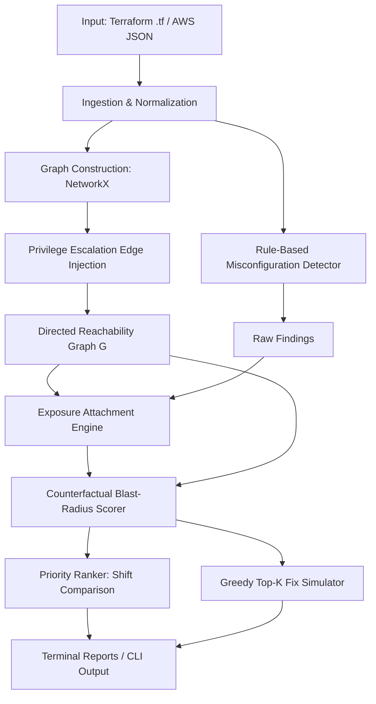

# Blast-Radius IAM

> **Context-Aware, Graph-Driven Static Analysis & Remediation for AWS IAM Misconfigurations**

[](https://www.python.org/downloads/)
[](LICENSE)
[]()
[]()

Traditional Cloud Security Posture Management (CSPM) and Infrastructure-as-Code (IaC) linters (e.g., Checkov, tfsec, Trivy) inspect cloud policies in isolation. They flag issues like `Action: *` or `Principal: *` based on static pattern matching and assign static severity labels (`HIGH`, `MEDIUM`, `LOW`).

In reality, **isolated severity is meaningless without reachability and asset sensitivity**. An unassumable role with `AdministratorAccess` poses zero immediate risk, whereas a `MEDIUM`-rated open trust policy on an unprivileged role can serve as the initial hop in an escalation chain that accesses high-value production databases.

**Blast-Radius IAM** solves this problem by transforming IAM configurations into a directed reachability graph. It correlates policy permissions, role assumption trusts, and AWS privilege escalation primitives to compute **counterfactual blast-radius scores** and synthesize **greedy optimal remediation plans** under engineering budget constraints.

---

## Table of Contents

- [The Core Problem: Context Blindness in Static Scanners](#the-core-problem-context-blindness-in-static-scanners)
- [Key Features](#key-features)
- [System Architecture](#system-architecture)
- [Scoring Methodology & Mathematical Model](#scoring-methodology--mathematical-model)
- [Privilege Escalation Primitives](#privilege-escalation-primitives)
- [Remediation & Fix Simulation](#remediation--fix-simulation)
- [Installation](#installation)
- [Quickstart & Demo](#quickstart--demo)
- [CLI Reference](#cli-reference)
- [Configuration](#configuration)
- [Benchmark & Evaluation Scenarios](#benchmark--evaluation-scenarios)
- [Experimental Evaluation Suite](#experimental-evaluation-suite)
- [Running Tests](#running-tests)
- [Project Structure](#project-structure)
- [License](#license)

---

## The Core Problem: Context Blindness in Static Scanners

### Traditional Scanner Blind Spots

1. **Alert Fatigue from Isolated Nodes:** An admin role with wildcard actions (`*`) that cannot be assumed by any external entity or user is labeled `HIGH` severity. Engineering teams waste time triaging unreachable configurations.
2. **Underestimating Multi-Hop Escalation Choke-Points:** An open trust policy (`Principal: "*"`) on an unprivileged role is tagged `MEDIUM`. If that role possesses `iam:PassRole` and `lambda:CreateFunction` permissions, an external attacker can escalate to a crown-jewel admin role and exfiltrate production data.
3. **Lack of Optimal Remediation Guidance:** Traditional scanners dump lists of hundreds of disconnected warnings without indicating which single fix breaks the maximum number of attack paths.

### The Blast-Radius Difference: Rank Inversion

Consider the worked example evaluated in `demo.py`:

```
[Attacker / Alice]
       │
       ▼ (can_assume: open trust)
  [dev-role] ────(can_escalate: PassRole + CreateFunction)────► [admin-role]
                                                                     │
                                                      (can_access)   ▼
                                                            [prod-customer-db]
[isolated-admin] (Action: *, Resource: *) ──► [Zero Inbound Paths / Unexposed]
```

| Finding ID | Location | Rule | Traditional Scanner Severity | Blast-Radius Score | Final Rank | Outcome |
| :--- | :--- | :--- | :---: | :---: | :---: | :--- |
| **F001** | `dev-role` | `open_trust` | **MEDIUM** (Rank 2) | **14.45** | **#1** | **Promoted (+1)**: Entry point choke-point |
| **F002** | `dev-role` | `excess_permission` | **MEDIUM** (Rank 3) | **11.24** | **#2** | **Promoted (+1)**: Escalation link to admin |
| **F007** | `isolated-admin` | `wildcard_action` | **HIGH** (Rank 1) | **0.00** | **#6** | **Demoted (-5)**: Isolated & unreachable |

Blast-Radius dynamically inverts the priorities: the "medium" entry-point choke-point is promoted to Priority 1, and the "high" unreachable wildcard finding is deprioritized to eliminate alert fatigue.

---

## Key Features

- **Automated IaC & JSON Parsing:** Ingests Terraform configurations (`.tf`) and AWS IAM account authorization exports (`aws iam get-account-authorization-details`).
- **Multi-Hop Reachability Graph:** Builds a directed graph representing Principals (`User`, `Role`), Entry Points (`EXTERNAL`, `User`), and Resources (`S3`, `RDS`, `KMS`, `SecretsManager`, `DynamoDB`, `Lambda`).
- **Privilege Escalation Engine:** Detects multi-action escalation primitives (e.g., `PassRole` combined with `lambda:CreateFunction` or `ec2:RunInstances`, `AttachRolePolicy`, `CreatePolicyVersion`, `UpdateAssumeRolePolicy`).
- **Graded Exposure Analysis:** Determines attacker reachability using entry-point weighting and distance decay.
- **Counterfactual Scoring:** Calculates risk based on the marginal loss of reachable asset value when a misconfiguration is resolved.
- **Greedy Top-$K$ Remediation Planner:** Employs a submodular-style greedy optimization algorithm to recommend the smallest set of policy changes that eliminates the greatest total environment risk.
- **Rich CLI & Reporting:** Colored terminal dashboards, side-by-side priority comparison tables, and step-by-step fix impact reports powered by `rich`.

---

## System Architecture

The analysis pipeline processes IaC or JSON inputs through 7 stages:



### Pipeline Stages

1. **Ingestion & Normalization (`parser_terraform.py`, `parser_json.py`):** Extracts IAM roles, users, policies, role-policy attachments, and cloud target resources.
2. **Graph Construction (`graph_builder.py`):** Instantiates principal and resource nodes, assigns asset sensitivity ratings, and maps `can_access` and `can_assume` relationships.
3. **Escalation Detection (`escalation.py`):** Analyzes identity-plane permissions to synthesize `can_escalate` graph edges.
4. **Misconfiguration Detection (`detector.py`):** Flags instances of `wildcard_action`, `wildcard_resource`, `open_trust`, and `excess_permission`.
5. **Exposure Analysis (`attach.py`):** Determines whether an external attacker or initial user identity can reach the misconfigured node.
6. **Counterfactual Blast-Radius Scoring (`scoring.py`):** Simulates the removal of finding edges to quantify the marginal reachability reduction.
7. **Greedy Fix Optimization (`fixes.py`):** Iteratively selects fixes that maximize risk reduction across the entire environment.

---

## Scoring Methodology & Mathematical Model

The Blast-Radius score quantifies the potential damage an attacker can inflict if they exploit a misconfiguration.

### 1. Graded Exposure Score

The exposure of a node $v$, denoted $E(v) \in [0, 1]$, measures the proximity and weight of all entry points that can reach $v$:

$$E(v) = \min\left(1.0, \sum_{u \in \text{EntryPoints}} w_u \cdot \frac{1}{1 + \text{dist}(u, v)}\right)$$

Where:
- $\text{EntryPoints} \in \{\text{EXTERNAL}, \text{Users}\}$
- $w_{\text{EXTERNAL}} = 1.0$, $w_{\text{User}} = 0.5$
- $\text{dist}(u, v)$ is the shortest path length from $u$ to $v$ in directed graph $G$.
- If no path exists from any entry point to $v$, $E(v) = 0.0$.

### 2. Reachable Asset Value with Geometric Decay

For any node $v$, its downstream reachable value is calculated with a distance decay factor $\gamma \in (0, 1]$ (default $\gamma = 0.8$):

$$V(v, G) = \sum_{r \in \text{Reachable}(v)} \text{Sensitivity}(r) \cdot \gamma^{\text{dist}(v, r) - 1}$$

- Closer resources contribute more heavily to risk than assets separated by multiple intermediate hops.
- Asset sensitivity values range from 1 to 10 (configured via `configs/sensitivity.yaml`).

### 3. Counterfactual Risk Differential

The score evaluates the counterfactual world $H = G \setminus \text{Edges}(f)$, where the edges enabled by finding $f$ are severed:

$$\Delta_{\text{sens}}(f) = V_{\text{with}}(f) - V_{\text{without}}(f)$$

$$\Delta_{\text{count}}(f) = \ln(1 + |\text{Reachable}_{\text{with}}|) - \ln(1 + |\text{Reachable}_{\text{without}}|)$$

- **For outgoing-edge findings (`excess_permission`, `wildcard_*`):** Evaluated from the perspective of the node itself ($v$).
- **For incoming-edge findings (`open_trust`):** Evaluated from the perspective of all entry points, capturing the total downstream blast radius that gets isolated when the trust boundary is sealed.

### 4. Final Blast-Radius Score

$$\text{Score}(f) = E(v) \times \left( w_{\text{sens}} \cdot \Delta_{\text{sens}}(f) + w_{\text{count}} \cdot \Delta_{\text{count}}(f) \right)$$

Hyperparameters (configured via `configs/weight.yaml`):
- $\gamma = 0.8$ (hop decay factor)
- $w_{\text{sens}} = 1.0$ (sensitivity weight)
- $w_{\text{count}} = 1.0$ (cardinality weight)
- $\epsilon = 0.05$ (exposure cutoff threshold)

---

## Privilege Escalation Primitives

`blastradius` inspects IAM statements for known AWS privilege escalation attack vectors and inserts `can_escalate` edges into the graph:

| Attack Vector | Required Actions | Mechanism / Consequence |
| :--- | :--- | :--- |
| **Policy Attachment** | `iam:AttachRolePolicy` or `iam:PutRolePolicy` | Attacker attaches `AdministratorAccess` directly to the target role. |
| **User Policy Injection** | `iam:AttachUserPolicy` or `iam:PutUserPolicy` | Attacker attaches high-privilege policies to a target user. |
| **Serverless Execution** | `iam:PassRole` + `lambda:CreateFunction` | Attacker passes high-privilege execution role to a newly deployed Lambda function and invokes it. |
| **Compute Instance Profile** | `iam:PassRole` + `ec2:RunInstances` | Attacker launches an EC2 instance with an attached administrative instance profile. |
| **Trust Policy Hijack** | `iam:UpdateAssumeRolePolicy` | Attacker modifies the trust policy of an existing role to permit assumption by their own principal. |
| **Policy Versioning** | `iam:CreatePolicyVersion` | Attacker creates a new default version of a customer-managed policy granting full permissions. |

---

## Remediation & Fix Simulation

Rather than treating fixes as disconnected checklist items, Blast-Radius formulates remediation as a **submodular combinatorial optimization problem** under an engineering budget $K$:

$$\text{Maximize } \Delta \text{Risk}(S) \quad \text{subject to } |S| \le K$$

### Greedy Top-$K$ Algorithm

1. Synthesize candidate concrete fixes:
   - `tighten_trust`: Restricts `Principal: "*"` to authorized ARNs (removes incoming `can_assume` edges).
   - `remove_escalation`: Strips escalation permissions such as `iam:PassRole` (removes outgoing `can_escalate` edges).
   - `narrow_permissions`: Scopes down wildcard actions/resources (removes `can_access` edges).
2. Measure the marginal risk drop for each candidate fix $f$ against current graph $G_i$:
   $$\Delta R(f) = \text{TotalRisk}(G_i) - \text{TotalRisk}(G_i \setminus f)$$
3. Pick $f^* = \arg\max \Delta R(f)$ and update graph $G_{i+1} = G_i \setminus f^*$.
4. Recompute graph reachability dynamically for the next step, accounting for paths already severed.

In practice, **1 to 2 targeted fixes frequently eliminate 70%–100% of the total exploitable risk** across an organization's cloud infrastructure.

---

## Installation

### Prerequisites

- Python 3.10 or higher
- Git

### Setup

```bash
# Clone the repository
git clone https://github.com/your-org/blast-radius-iam.git
cd blast-radius-iam

# Create and activate a virtual environment
python -m venv .venv

# On Linux/macOS:
source .venv/bin/activate
# On Windows:
.venv\Scripts\Activate.ps1

# Install package and dependencies in editable mode
pip install -e .

# Install optional test dependencies
pip install -e .[test]
```

---

## Quickstart & Demo

Run the end-to-end interactive demo to observe the 7-phase analysis pipeline, graph path detection, rank inversion, and greedy remediation plan:

```bash
# Using installed CLI
blastradius demo

# Or directly with Python
python demo.py
```

### Quick Run on Terraform File

Analyze a Terraform configuration and inspect prioritized findings:

```bash
blastradius score data/synthetic/case1/main.tf
```

Simulate the optimal 2-step remediation plan:

```bash
blastradius fix data/synthetic/case1/main.tf --budget 2
```

---

## CLI Reference

The CLI provides five primary subcommands:

```
usage: blastradius [-h] {analyze,score,fix,demo,benchmark} ...
```

### 1. `blastradius analyze <path>`
Parses the target Terraform file or directory, constructs the reachability graph, and outputs node/edge graph statistics.

```bash
blastradius analyze data/synthetic/case1/main.tf
```

### 2. `blastradius score <path>`
Executes the full pipeline and renders a table of misconfigurations ranked strictly by their Blast-Radius risk score.

```bash
blastradius score data/synthetic/case1/main.tf
```

### 3. `blastradius fix <path> [--budget BUDGET]`
Runs greedy fix simulation and proposes the top-$K$ most impactful remediation steps to achieve maximum risk reduction.

```bash
# Propose the top 3 best fixes
blastradius fix data/synthetic/case3/chain_roles.tf --budget 3
```

### 4. `blastradius demo`
Executes the comprehensive paper walkthrough demo illustrating rank inversion, exposure analysis, and fix simulation.

### 5. `blastradius benchmark`
Executes the synthetic benchmark suite across all test cases under `data/synthetic/` and reports comparative risk reduction metrics.

```bash
blastradius benchmark
```

---

## Configuration

Custom rules and scoring weights are configured via YAML files in `configs/`:

### 1. Asset Sensitivity Rules (`configs/sensitivity.yaml`)

Assigns critical sensitivity ratings (1–10) to cloud assets using glob matching against resource names and ARNs:

```yaml
rules:
  - { match: "*prod*db*",         score: 10 }
  - { match: "*rds*",             score: 9  }
  - { match: "*secretsmanager*",  score: 9  }
  - { match: "*kms*",             score: 8  }
  - { match: "*prod*",            score: 8  }
  - { match: "*backup*",          score: 7  }
  - { match: "*iam*role/*admin*", score: 9  }
  - { match: "*dev*",             score: 2  }
  - { match: "*test*",            score: 1  }
default: 3
```

### 2. Scoring Hyperparameters (`configs/weight.yaml`)

Controls path length decay and objective weights:

```yaml
gamma: 0.8            # Path length decay factor (0 < gamma <= 1.0)
w_count: 1.0          # Weight assigned to reachable resource count
w_sensitivity: 1.0    # Weight assigned to resource sensitivity
exposed_epsilon: 0.05 # Minimum exposure threshold for a finding to be marked exposed
```

---

## Benchmark & Evaluation Scenarios

The `data/synthetic/` directory contains structured Terraform benchmark cases demonstrating distinct security topology challenges:

| Scenario | Directory | Key Characteristics | Blast-Radius Behavior |
| :--- | :--- | :--- | :--- |
| **Case 1: Open Role to S3** | `case1/` | Open trust on `dev-role` with wildcard access to S3. | Identifies `open_trust` as #1 choke-point. Tightening trust eliminates 100% of risk. |
| **Case 2: Wildcard Roles** | `case2/` | Single open role with broad action permissions. | Computes accurate exposure and remediates in a single step. |
| **Case 3: Role Chaining** | `case3/` | Multi-hop privilege chain (`role1 -> role2 -> role3 -> role4 -> role5`). | Identifies upstream entry points. Severing `role1` cuts access to all downstream nodes. |
| **Case 4: Isolated Admin** | `case4/` | Wildcard `*` on `*` policy attached to role trusted only by `ec2.amazonaws.com` (no entry path). | **Zero Blast-Radius score (0.00)**. Suppresses false positive alarm that traditional scanners rank as CRITICAL. |
| **Case 5: Benign Configuration** | `case5/` | Least-privilege IAM configuration without wildcards or escalation primitives. | Clean scan, 0 findings, 0 risk. |

---

## Experimental Evaluation Suite

The `experiments/` directory contains scripts designed to evaluate Blast-Radius against state-of-the-art benchmarks:

- **Baseline Comparison (`experiments/eval_baseline.py`):**
  - Measures ranking disagreement between generic scanner severity and Blast-Radius.
  - Computes **Kendall-tau rank distance** and records rank inversion percentages across datasets (`synthetic`, `iam_vulnerable`, `terragoat`, `cloudgoat`).
- **Ablation Study (`experiments/eval_ablation.py`):**
  - Evaluates the marginal impact of each component by comparing 5 variants:
    1. Full model
    2. Exposure-only
    3. Severity-only (traditional baseline)
    4. No sensitivity ($w_{\text{sens}} = 0$)
    5. No decay ($\gamma = 1.0$)
- **Ground Truth Evaluation (`experiments/eval_precision.py`):**
  - Evaluates **Precision@K**, **Recall@K**, and Average Rank on known privilege escalation attack scenarios from `iam_vulnerable`.
- **Sensitivity & Robustness Sweep (`experiments/sensitivity_analysis.py`):**
  - Sweeps $\gamma \in [0.6, 0.9]$, $w_{\text{sens}} \in [0.5, 2.0]$, and $w_{\text{count}} \in [0.5, 2.0]$ across 64 parameter combinations to verify ranking stability.

---

## Running Tests

The test suite validates parser accuracy, graph construction, privilege escalation detection, counterfactual scoring, and fix simulation.

Run tests using `pytest`:

```bash
# Run full test suite
pytest

# Run tests with verbose output
pytest -v

# Run a specific test module
pytest tests/test_scoring.py -v
```

### Verified Assertions

- `test_headline_claim_rank_inversion`: Validates that an exposed `open_trust` finding on an unprivileged escalation role outranks an unexposed `wildcard_action` on an isolated admin role.
- `test_passrole_lambda_escalation`: Verifies edge injection when `iam:PassRole` and `lambda:CreateFunction` are present.
- `test_greedy_fixes`: Verifies that greedy fix selection monotonically decreases total environment risk.
- `test_terraform_parser`: Validates parsing of IAM roles, policies, heredocs, and `jsonencode` blocks.

---

## Project Structure

```
blast-radius-iam/
├── .github/
│   └── workflows/
│       └── ci.yml               # GitHub Actions CI workflow
├── configs/
│   ├── sensitivity.yaml         # Asset sensitivity rules (1-10)
│   └── weight.yaml              # Scoring decay (gamma) & weight parameters
├── data/
│   └── synthetic/               # Synthetic Terraform benchmark scenarios
│       ├── case1/               # Single open role accessing S3
│       ├── case2/               # Wildcard roles
│       ├── case3/               # Deep 5-role escalation chain
│       ├── case4/               # Isolated wildcard admin (demonstrates demotion)
│       ├── case5/               # Benign baseline
│       └── terraform_example/   # Reference IaC template
├── experiments/
│   ├── eval_ablation.py         # Component ablation study
│   ├── eval_baseline.py         # Kendall-tau & rank inversion baseline analysis
│   ├── eval_precision.py        # Precision@K & Recall@K on ground truth privesc
│   └── sensitivity_analysis.py  # Hyperparameter grid sweep
├── src/
│   └── blastradius/
│       ├── __init__.py
│       ├── attach.py            # Exposure score calculation & finding binding
│       ├── cli.py               # Rich interactive command-line interface
│       ├── detector.py          # IAM misconfiguration detector
│       ├── escalation.py        # AWS privilege escalation primitives
│       ├── fixes.py             # Greedy Top-K remediation planner
│       ├── graph_builder.py     # NetworkX reachability graph constructor
│       ├── models.py            # Dataclasses (Principal, Statement, Finding, ScoredFinding)
│       ├── parser_json.py       # AWS JSON authorization details parser
│       ├── parser_terraform.py  # Terraform HCL2 parser
│       ├── ranking.py           # Priority ranking & rank shift comparison
│       └── scoring.py           # Counterfactual blast-radius scoring engine
├── tests/
│   ├── test_detector.py         # Detector rule unit tests
│   ├── test_fixes.py            # Fix generation & simulation tests
│   ├── test_graph.py            # Graph construction & escalation edge tests
│   ├── test_parser.py           # Terraform & JSON parser tests
│   └── test_scoring.py          # Blast-radius score & rank inversion tests
├── demo.py                      # Standalone interactive demonstration
├── pyproject.toml               # Package build configuration & CLI entrypoint
├── requirements.txt             # Project dependencies
└── README.md                    # Project documentation
```

## Contributors & Contributions

**Hrushikesh & Bhuvan**
- Project setup, data models, and Terraform/JSON parsing.
- Asset sensitivity and exposure analysis improvements.
- Counterfactual blast-radius scoring and evaluation suite.
- Demo implementation and improvements.

**Mohith & Pawan Tej**
- Graph construction and privilege escalation detection.
- Misconfiguration detection and reachability analysis.
- Blast-radius scoring and priority ranking.
- Greedy remediation, benchmarking, and CI integration.

---

## License

This project is licensed under the MIT License. See the [LICENSE](LICENSE) file for details.